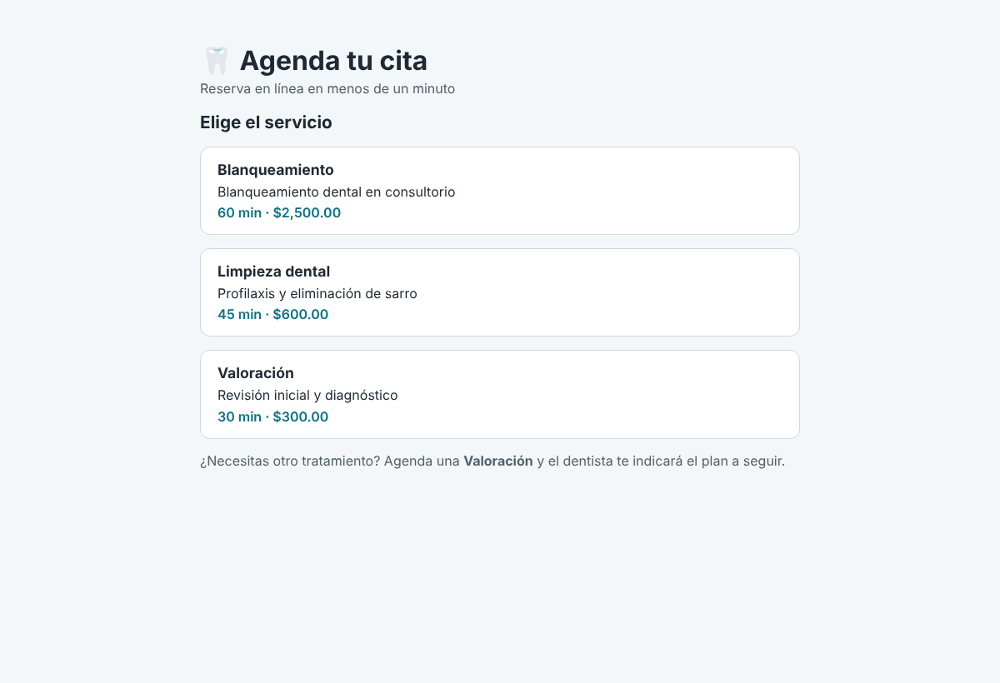
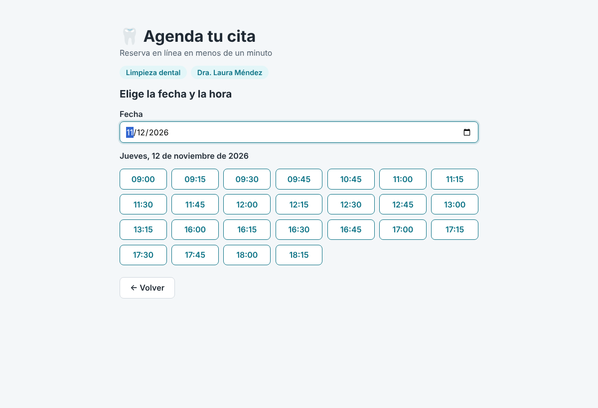
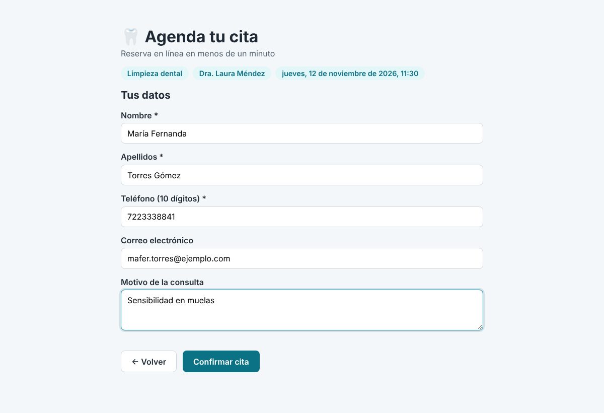
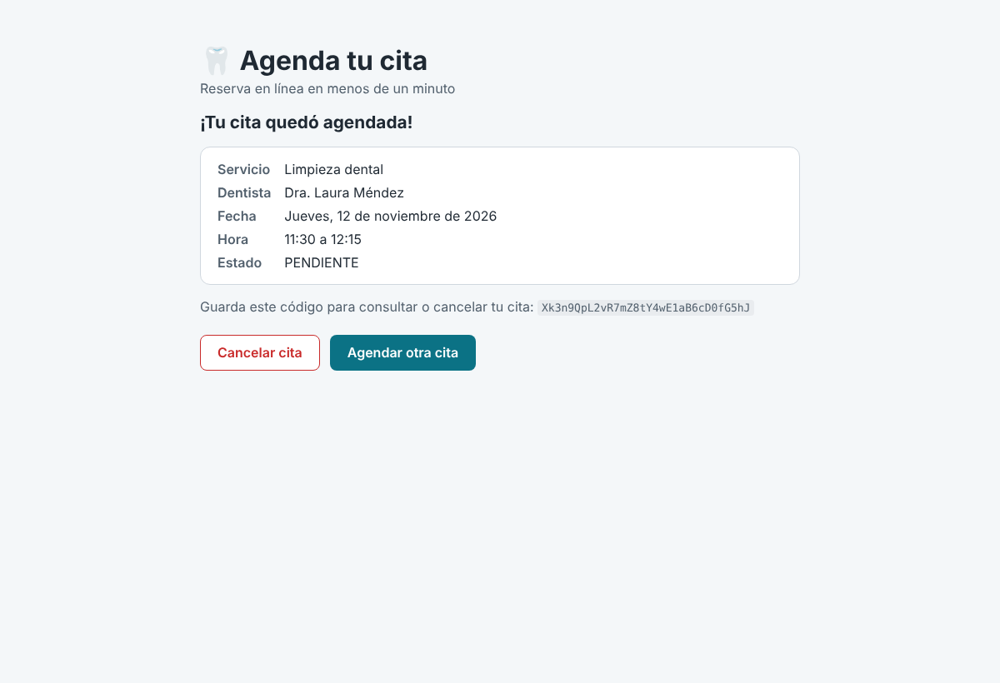
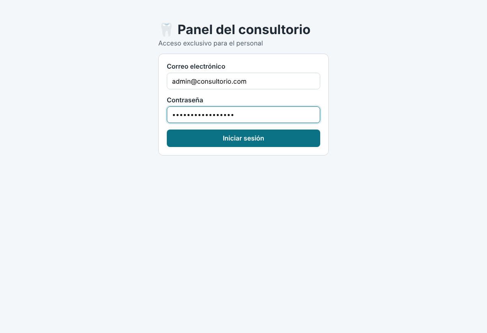
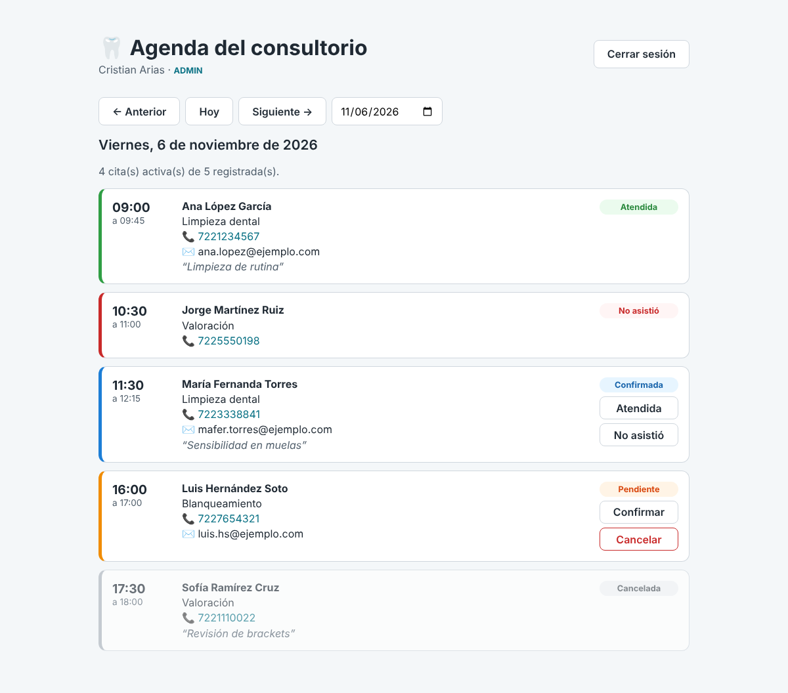
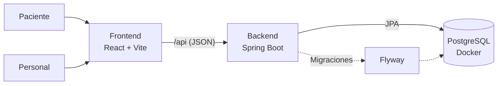

# 🦷 Sistema de Citas Dental

Sistema web full-stack para gestionar las citas de un consultorio dental. Los pacientes reservan en línea sin crear una cuenta, y el personal administra la agenda del día desde un panel protegido con inicio de sesión.


---

## 📸 Capturas

### Reserva del paciente
| Elegir servicio | Elegir fecha y hora |
|---|---|
|  |  |

| Datos del paciente | Confirmación |
|---|---|
|  |  |

### Panel del personal
| Inicio de sesión | Agenda del día |
|---|---|
|  |  |

---

## ✨ Funcionalidades

### Para el paciente (sin cuenta)
- Consulta de servicios con su duración y precio.
- Horarios disponibles calculados en tiempo real según el horario laboral del dentista, sus bloqueos, las citas ya agendadas y la duración del servicio.
- Reserva con validación de datos y un **código único** para consultar o cancelar la cita.
- Al cancelar, el horario se libera automáticamente para otro paciente.
- Los tratamientos complejos (endodoncia, resinas, extracciones) no se reservan en línea: primero se agenda una valoración.

### Para el personal del consultorio
- Inicio de sesión con **JWT** y control de acceso por **roles** (administrador, recepcionista y dentista).
- Agenda diaria con navegación entre días y datos de contacto del paciente.
- Registro del estado de cada cita: pendiente, confirmada, atendida, no asistió o cancelada, con reglas de negocio que impiden cambios inválidos.

---

## 🔐 Seguridad

El sistema maneja datos personales de pacientes, por lo que la seguridad se trató como un requisito desde el diseño:

| Medida | Detalle |
|---|---|
| **Contraseñas con BCrypt** | Solo se almacena el hash con sal aleatoria y factor de costo; nunca la contraseña. |
| **Autenticación sin estado con JWT** | Tokens firmados con HS256, con expiración y validación del emisor. |
| **Autorización por roles** | Las rutas `/api/admin/**` y `/api/personal/**` se protegen según el rol incluido en el token. |
| **Prevención de enumeración de usuarios** | El login responde el mismo mensaje y en un tiempo similar, exista o no el correo. |
| **Secretos fuera del código** | Contraseñas, secreto JWT y administrador inicial se leen de un archivo `.env` excluido de Git. |
| **Tokens públicos no adivinables** | Las citas del paciente se identifican con un token de 256 bits generado con `SecureRandom`, no con IDs consecutivos. |
| **Concurrencia a nivel de base de datos** | Una restricción de exclusión en PostgreSQL impide citas empalmadas aunque dos personas reserven al mismo tiempo. |
| **Errores estandarizados** | Respuestas en formato *Problem Details* (RFC 9457) sin exponer detalles internos. |

---

## 🏗️ Arquitectura



El backend sigue una arquitectura por capas:

```
Controller → Service → Repository → Base de datos
  (HTTP)     (reglas)    (JPA)
```

### Cálculo de disponibilidad
1. Se obtiene el horario laboral del dentista para el día de la semana.
2. Se reúnen los intervalos ocupados: citas activas y bloqueos (vacaciones, cursos, comidas).
3. Se recorre el horario en intervalos de 15 minutos y solo se conservan los horarios donde cabe completa la duración del servicio.
4. Se descartan las horas que ya pasaron, según la zona horaria del consultorio.

### Restricción anti-empalmes
```sql
CONSTRAINT citas_sin_empalmes EXCLUDE USING gist (
    dentista_id WITH =,
    tsrange(inicio, fin) WITH &&
) WHERE (estado <> 'CANCELADA')
```
Aunque dos solicitudes pasen la validación al mismo tiempo, PostgreSQL rechaza la segunda y la API responde `409 Conflict`.

---

## 🛠️ Tecnologías

| Capa | Tecnologías |
|---|---|
| **Backend** | Java 25, Spring Boot 4, Spring Security, OAuth2 Resource Server (JWT), Spring Data JPA, Hibernate, Bean Validation, Lombok |
| **Base de datos** | PostgreSQL 17, Flyway (migraciones versionadas) |
| **Frontend** | React 19, Vite |
| **Infraestructura** | Docker Compose |
| **Herramientas** | Git, GitHub, Maven, REST Client |

---

## 📁 Estructura del proyecto

```
sistema-citas-dental/
├── backend/                  API REST con Spring Boot
│   ├── src/main/java/.../
│   │   ├── config/           Seguridad, JWT y administrador inicial
│   │   ├── controller/       Endpoints REST
│   │   ├── dto/              Objetos de entrada y salida de la API
│   │   ├── entity/           Entidades JPA
│   │   ├── exception/        Manejo global de errores
│   │   ├── repository/       Acceso a datos
│   │   └── service/          Reglas de negocio
│   ├── src/main/resources/
│   │   └── db/migration/     Scripts de Flyway
│   └── peticiones.http       Pruebas manuales de la API
├── frontend/                 Aplicación React
│   └── src/
│       ├── components/       Pasos del asistente de reserva
│       └── panel/            Panel del personal
├── docs/capturas/            Imágenes del README
├── docker-compose.yml        Base de datos PostgreSQL
└── .env.example              Variables de entorno necesarias
```

---

## 🔌 API

### Pública (sin autenticación)
| Método | Ruta | Descripción |
|---|---|---|
| `GET` | `/api/public/servicios` | Servicios que se pueden reservar en línea |
| `GET` | `/api/public/dentistas` | Dentistas activos |
| `GET` | `/api/public/disponibilidad?dentistaId=&servicioId=&fecha=` | Horarios libres de un día |
| `POST` | `/api/public/citas` | Crear una cita |
| `GET` | `/api/public/citas/{token}` | Consultar una cita con su código |
| `PATCH` | `/api/public/citas/{token}/cancelar` | Cancelar una cita |

### Personal (requiere `Authorization: Bearer <token>`)
| Método | Ruta | Descripción |
|---|---|---|
| `POST` | `/api/auth/login` | Iniciar sesión y obtener el token |
| `GET` | `/api/personal/yo` | Datos del usuario con sesión iniciada |
| `GET` | `/api/personal/citas?fecha=` | Agenda del día |
| `PATCH` | `/api/personal/citas/{id}/estado` | Cambiar el estado de una cita |

En [`backend/peticiones.http`](backend/peticiones.http) se incluyen ejemplos listos para ejecutar con la extensión REST Client de VS Code.

---

## 🚀 Ejecución local

### Requisitos
- Java 25
- Node.js 20 o superior
- Docker Desktop

### 1. Variables de entorno
Se copia `.env.example` como `.env` en la raíz del proyecto y se completan los valores:

```bash
cp .env.example .env
```

| Variable | Descripción |
|---|---|
| `DB_NAME`, `DB_USER`, `DB_PASSWORD` | Datos de la base de datos |
| `JWT_SECRET` | Secreto para firmar los tokens (mínimo 32 caracteres aleatorios) |
| `ADMIN_NOMBRE`, `ADMIN_EMAIL`, `ADMIN_PASSWORD` | Administrador que se crea en el primer arranque (contraseña de 12 caracteres o más) |

### 2. Base de datos
```bash
docker compose up -d
```

### 3. Backend
```bash
cd backend
./mvnw spring-boot:run        # En Windows: .\mvnw.cmd spring-boot:run
```
Flyway crea las tablas y los datos iniciales automáticamente. La API queda en `http://localhost:8080`.

### 4. Frontend
```bash
cd frontend
npm install
npm run dev
```
- Reserva del paciente: `http://localhost:5173`
- Panel del personal: `http://localhost:5173/panel`

---

## 🗺️ Próximas mejoras
- [ ] Límite de intentos de inicio de sesión y de reservas por IP.
- [ ] Pruebas automáticas con JUnit y Testcontainers.
- [ ] Recordatorios por correo y WhatsApp 24 horas antes de la cita.
- [ ] Expediente clínico básico y bitácora de auditoría.
- [ ] Integración continua con GitHub Actions y despliegue en la nube.

---

## 👤 Autor

**Cristian Serafín Arias Sánchez**
Desarrollador Full-Stack Junior · Ingeniero en Sistemas Computacionales con especialidad en Ciberseguridad
Toluca, Estado de México
